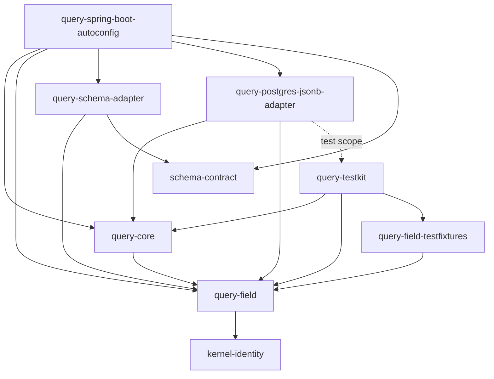
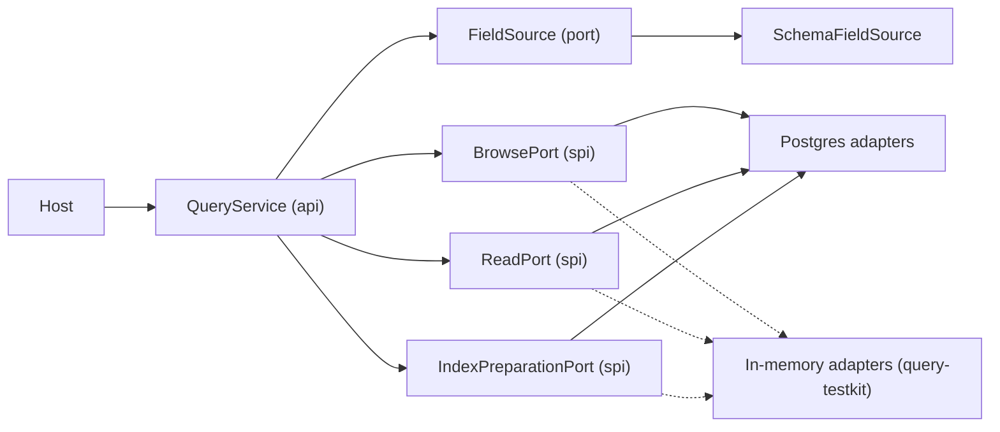
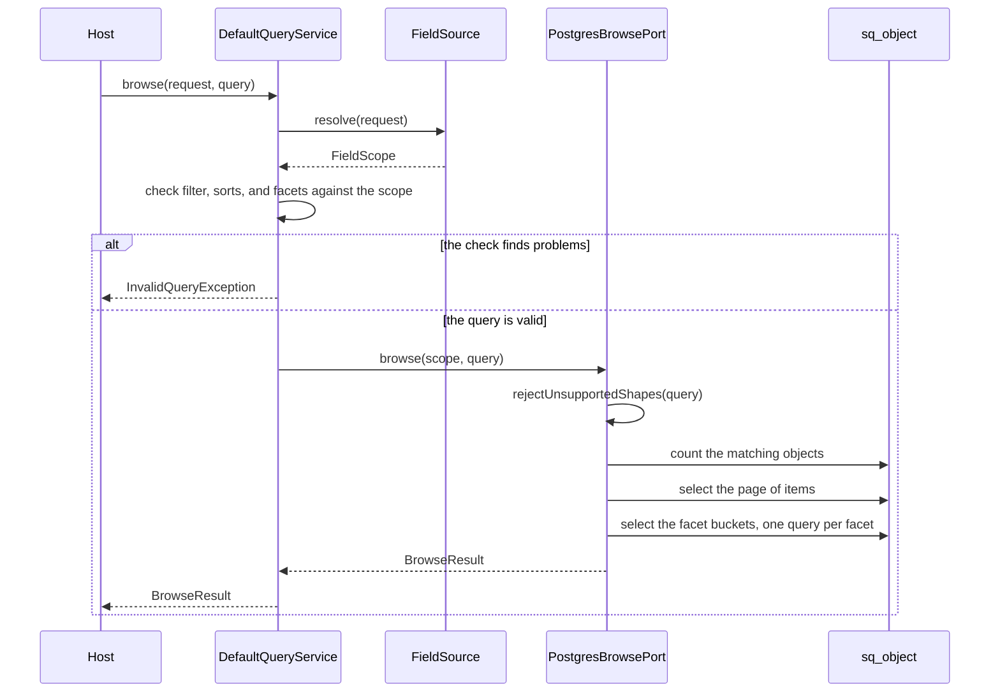
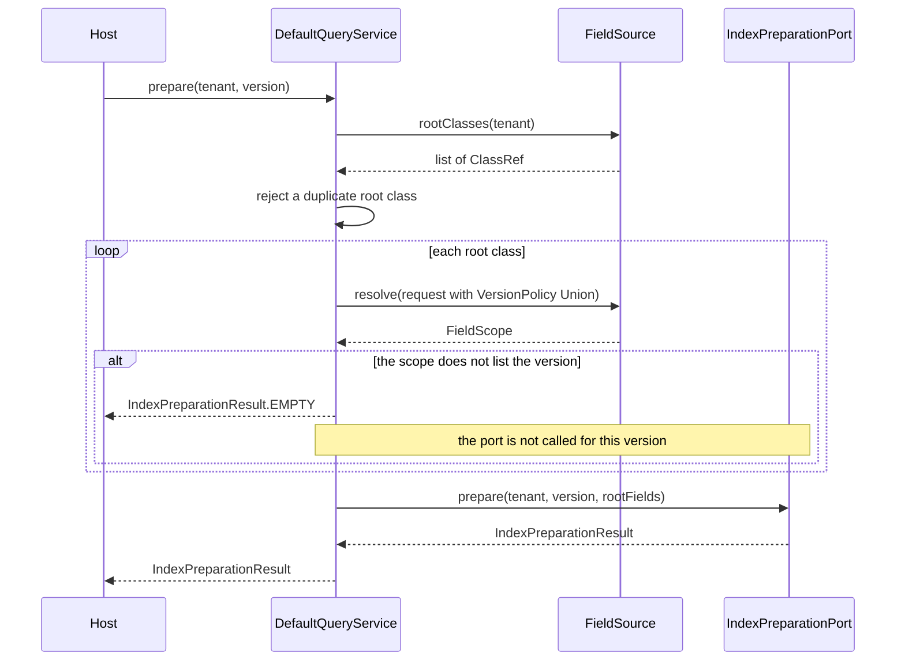
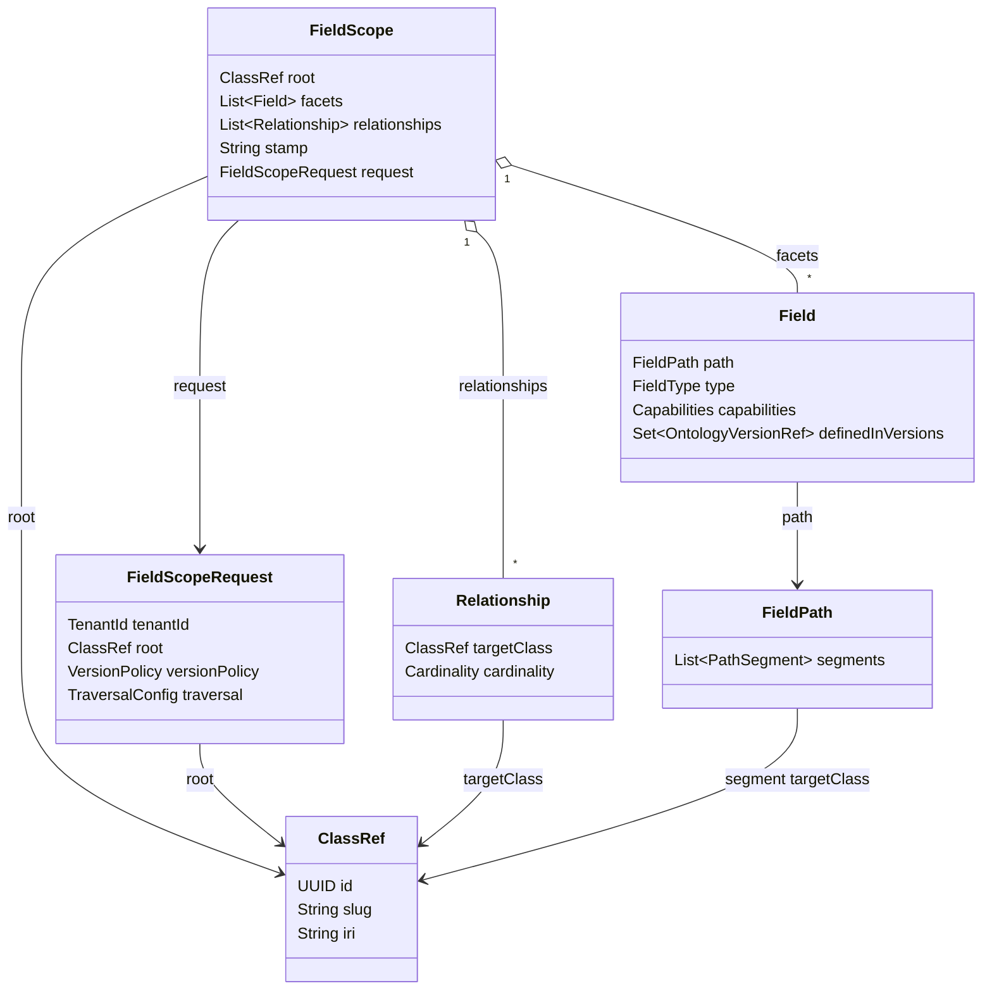
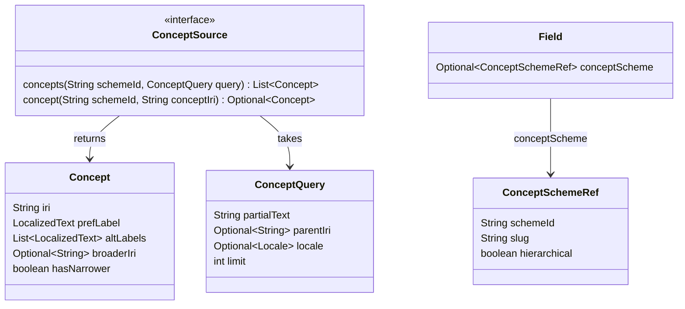
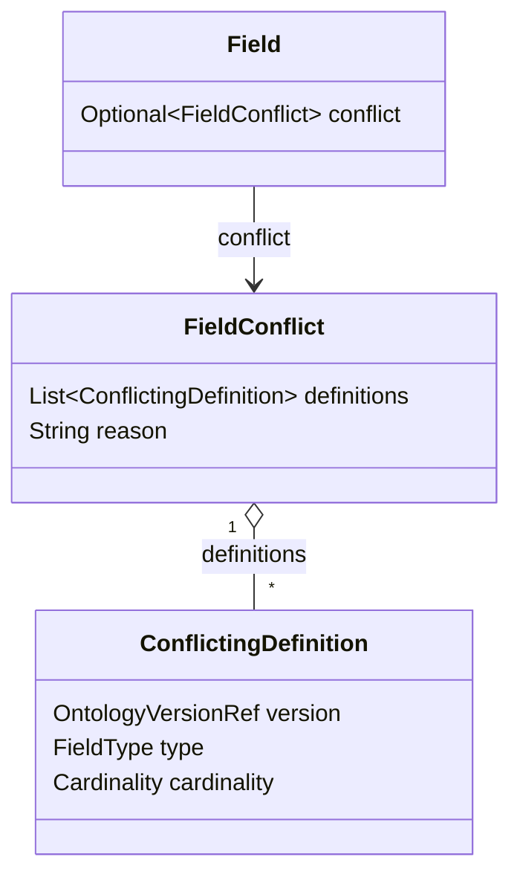

# sequeless-query

sequeless-query is the Query side of Sequeless, which provides Browse, Read, and index preparation over the Field contract.

## Concepts

| Term | Meaning |
|---|---|
| Host | The application that uses this library. |
| Query side | The read side of Sequeless. It provides Browse, Read, and index preparation. |
| Command side | The write side of Sequeless. The Query side reads the `sq_object` table, which the Command side owns. |
| Field | A queryable property, reached from a root class. A Field has a type, a cardinality, and Capabilities. |
| Capabilities | 4 independent flags of a Field: `filterable`, `facetable`, `searchable`, and `sortable`. No flag implies another. |
| Field contract | The vocabulary of the `query-field` module. It states what a caller can filter, facet, search, and sort. The Query side sees the schema only through this contract. |
| FieldSource | The port that resolves a FieldScope from a FieldScopeRequest. |
| FieldScopeRequest | The input to FieldSource. It names the tenant, the root class, the VersionPolicy, and the optional Principal. |
| FieldScope | The result of resolving a FieldScopeRequest. It holds the Fields of a root class and the relationships that a caller can follow. |
| VersionPolicy | The rule that reconciles several ontology versions. It is `Union`, `Intersection`, or `Pinned`. |
| Browse | A query over stored objects. It filters, sorts, pages, counts facet buckets, and searches text. |
| Read | A lookup of a stored object by its identifier. It returns an empty result when the object does not exist, is soft-deleted, or belongs to another tenant. |
| Index preparation | The creation of the index structures that Browse and Read use. The host calls `QueryService.prepare` after each ontology version becomes active. |
| Ontology version | A version of an ontology. The `OntologyVersionRef` type holds its number, which is 1 or greater. |
| Principal | The identity of the requester. It comes from kernel-identity, and it holds an identifier and a set of roles. |
| Concept scheme | A shared vocabulary of concepts. It is not tenant-owned. A Field can name 1 scheme, and `ConceptSource` reads its concepts. |
| Merge conflict | A disagreement on the `FieldType` or `Cardinality` of 1 property between versions in scope. The Field carries a `FieldConflict`. |
| Port | An interface that connects the core to other code. The 3 Query ports are `BrowsePort`, `ReadPort`, and `IndexPreparationPort`. |
| Adapter | A class that implements a port. |

## Modules

The root `pom.xml` is an aggregator. It is not deployed. It lists 7 modules.

| Module | Role | Version |
|---|---|---|
| `query-field` | The Field contract: the `Field`, `FieldScope`, `FieldSource`, and `ConceptSource` types. | 0.1.1 |
| `query-field-testfixtures` | Test fixtures, an in-memory `FieldSource`, and contract tests for `FieldSource` implementations. | 0.2.0 |
| `query-core` | `QueryService`, the 3 Query ports, and the use cases. | 0.2.1 |
| `query-schema-adapter` | `SchemaFieldSource`, which builds Fields from the schema contract. | 0.2.3 |
| `query-postgres-jsonb-adapter` | Postgres adapters for the 3 Query ports, and the Query migrations. | 0.2.1 |
| `query-testkit` | Contract tests and in-memory references for the 3 Query ports. | 0.2.1 |
| `query-spring-boot-autoconfig` | Spring Boot autoconfiguration that wires the other modules. | 0.4.0 |

The modules depend on each other as follows:

- `query-field` depends on kernel-identity only.
- `query-field-testfixtures` depends on `query-field`.
- `query-core` depends on `query-field`.
- `query-schema-adapter` depends on `query-field` and schema-contract.
- `query-testkit` depends on `query-core`, `query-field`, and `query-field-testfixtures`.
- `query-postgres-jsonb-adapter` depends on `query-core` and `query-field`. It uses `query-testkit` in test scope.
- `query-spring-boot-autoconfig` depends on `query-core`, `query-field`, `query-schema-adapter`, `query-postgres-jsonb-adapter`, and schema-contract.



Modules from outside this repository are kernel-identity, kernel-values, filter-core, filter-sql-adapter, filter-sql-postgres-adapter, and schema-contract.

## Architecture

The Query side uses a hexagonal shape. The host calls `QueryService`, which is the API. `QueryService` calls the ports. The ports are the SPI. Adapters implement the ports.



The Postgres adapters are `PostgresBrowsePort`, `PostgresReadPort`, and `PostgresIndexPreparation`. They are the production adapters. The dotted lines show the in-memory adapters, which tests use.

### Browse flow

`QueryService.browse` resolves the scope, checks the query against the scope, and then calls `BrowsePort.browse`. The port is not called when the check finds a problem.



### Prepare flow

`QueryService.prepare` lists the root classes of the tenant and resolves each root class. It applies the version guard before it calls `IndexPreparationPort`.



## Contracts

The Query side has 3 contracts. The API is what the host calls. The SPI is what adapters implement. The Field contract is the vocabulary that both sides share.

### API for hosts

The API is in the package `org.sequeless.query.api` of `query-core`. `QueryService` is the entry point. `DefaultQueryService` implements it.

| Method | Returns | What it does | Throws |
|---|---|---|---|
| `browse(FieldScopeRequest request, BrowseQuery query)` | `BrowseResult` | Resolves the scope, checks the query against the scope, and runs the browse. | `InvalidQueryException` (the port is not called), `FieldResolutionException`, `NullPointerException` |
| `read(Scope scope, ReadRequest request)` | `Optional<ObjectView>` | Reads one object by identifier. The result is empty when the object does not exist, is soft-deleted, or belongs to another tenant. | `NullPointerException` |
| `prepare(TenantId tenant, OntologyVersionRef version)` | `IndexPreparationResult` | Prepares the index structures for the root classes of the tenant. Returns `IndexPreparationResult.EMPTY`, without a port call, when the version is superseded. | `IllegalArgumentException` (duplicate root class), `IllegalStateException` (resolved root differs from the listed root), `FieldResolutionException`, `NullPointerException` |

The value records of the API are these:

| Record | What it holds | Rules |
|---|---|---|
| `BrowseQuery` | `Optional<FilterNode> filter`, `Optional<String> text`, `List<Sort> sorts`, `Page page`, `List<FieldPath> facets` | The `sorts` and `facets` lists are copied. No component is `null`. |
| `BrowseResult` | `List<ObjectView> items`, `long total`, `Map<FieldPath, List<FacetBucket>> facets` | The `total` counts all matching objects, not only the page. |
| `ObjectView` | `ObjectId id`, `TypeRef type`, `TenantId tenant`, `long version`, `Optional<String> state`, `Map<PropertyRef, Value> properties`, `Audit audit`, `boolean deleted` | Reference components must not be null. `version` must be 1 or greater. |
| `ReadRequest` | `ObjectId id` | None. |
| `Page` | `int number`, `int size` | The `number` is 0-based and must not be negative. The `size` must be from 1 to 500. |
| `Sort` | `FieldPath path`, `Direction direction` | `Direction` is `ASC` or `DESC`. |
| `FacetBucket` | `String value`, `long count` | None. |
| `Audit` | `Instant createdAt`, `String createdBy`, `Instant updatedAt`, `String updatedBy` | None. |
| `PropertyRef`, `TypeRef` | An `iri` string | None. |
| `IndexPreparationResult` | `List<FieldPath> newlyRegistered` | The constant `EMPTY` has an empty list. |

`InvalidQueryException` extends `RuntimeException`. Its method `problems()` returns the list of problems as strings. The public helpers `FieldKey` and `FieldRegistries.of(FieldScope)` are also in the package `api`. The Postgres adapter calls `FieldRegistries.of`.

A host that does not use Spring calls `QueryServiceFactory.create(FieldSource, BrowsePort, ReadPort, IndexPreparationPort)` to get a `QueryService`.

### SPI for adapters

The Query ports are in the package `org.sequeless.query.spi` of `query-core`. The `FieldSource` port is in the package `org.sequeless.query.field.spi` of `query-field`.

| Port | Production implementation | Test implementation |
|---|---|---|
| `BrowsePort` | `PostgresBrowsePort` | `InMemoryBrowsePort` |
| `ReadPort` | `PostgresReadPort` | `InMemoryReadPort` |
| `IndexPreparationPort` | `PostgresIndexPreparation` | `InMemoryIndexPreparationPort`, which also has `awaitPrepared()` |
| `FieldSource` | `SchemaFieldSource` | `InMemoryFieldSource` |
| `ConceptSource` | None | `InMemoryConceptSource` |

The Postgres adapters are in `query-postgres-jsonb-adapter`. The in-memory Query adapters are in `query-testkit`. `SchemaFieldSource` is in `query-schema-adapter`. `InMemoryFieldSource` and `InMemoryConceptSource` are in `query-field-testfixtures`.

Each port puts these obligations on an adapter:

- `BrowsePort.browse(FieldScope scope, BrowseQuery query)`:
  - The adapter must throw `NullPointerException` for a `null` argument.
  - The adapter must take the tenant from `scope.request().tenantId()`.
  - The adapter must not return soft-deleted objects.
  - The adapter must throw `InvalidQueryException` for a filter node other than `AndFilter`, `OrFilter`, or `FieldFilter`.
  - The adapter must throw `InvalidQueryException` for a traversal path in a filter, sort, or facet.
  - The adapter must throw `InvalidQueryException` for the `like` and `not like` operators.
  - A page past the last page returns empty items and the correct total. It does not throw.
- `ReadPort.read(Scope scope, ReadRequest request)`:
  - The adapter must throw `NullPointerException` for a `null` argument.
  - The adapter must return an empty result for a missing, soft-deleted, or other-tenant object.
- `IndexPreparationPort.prepare(TenantId tenant, OntologyVersionRef version, Map<ClassRef, List<Field>> rootFields)`:
  - The adapter must throw `NullPointerException` for a `null` argument. It must also throw it for a `null` map key or value.
  - The call must be idempotent. A repeat call with the same version returns an empty `newlyRegistered`.
  - The adapter must not check the version against the Fields.

The `BrowseContract`, `ReadContract`, and `IndexPreparationContract` classes in `query-testkit` test these obligations.

### Field contract

The Field contract is in `query-field`. A caller sends a `FieldScopeRequest` to a `FieldSource`. The `FieldSource` returns a `FieldScope`.

- `FieldScopeRequest` holds `TenantId tenantId`, `ClassRef root`, `VersionPolicy versionPolicy`, `TraversalConfig traversal`, `Optional<Principal> principal`, and `Optional<Locale> locale`.
- `FieldScope` holds the root class, the `Field` list (`facets`), the `Relationship` list, a `stamp`, the `ontologyVersions`, the `concreteTypes`, and the request that created it.
- `Field` describes one queryable property. It has a `FieldPath`, a `FieldType`, a `Cardinality`, `Capabilities`, labels, and a set `definedInVersions`. The set `definedInVersions` must not be empty.
- `FieldPath` is a list of `PathSegment` records. A path with more than 1 segment traverses relationships. The method `isTraversing` tests this.
- `Relationship` describes an edge that a caller can follow. It names the target `ClassRef` and the versions that define the edge.



The `VersionPolicy` of the request decides how `FieldSource` reconciles ontology versions:

- `Union` merges the Fields of all versions in scope. It matches Fields by property identifier, not by slug. The documentation calls it the default, but no code selects it implicitly. Each request must name a VersionPolicy.
- `Pinned(OntologyVersionRef version)` resolves against exactly 1 version. `SchemaFieldSource` raises `VERSION_NOT_FOUND` when that version is not active. It raises `UNKNOWN_PATH` when a path names a missing property.
- `Intersection` keeps only the Fields that every version defines. The documentation says it fails with `EMPTY_INTERSECTION` when no Field remains. No production `FieldSource` enforces this rule. `SchemaFieldSource` resolves `Intersection` like `Union`.

`FieldSource` has 4 methods and no default methods:

| Method | Returns | Question it answers |
|---|---|---|
| `resolve(FieldScopeRequest request)` | `FieldScope` | Which Fields and relationships does the root class have? |
| `expand(FieldScope scope, FieldPath relationship)` | `FieldScope` | Which Fields does the scope have after it follows 1 relationship? |
| `describe(FieldScopeRequest request, FieldPath path)` | `Field` | What is the Field at 1 path? |
| `rootClasses(TenantId tenant)` | `List<ClassRef>` | Which root classes does the tenant have? |

Every `FieldSource` error is a `FieldResolutionException` that carries a `FieldErrorCode`. The enum has 12 constants. `ConceptSource` has the methods `concepts` and `concept`. It throws only `SCHEME_UNAVAILABLE`.

#### Concept values

A Field can take its values from a concept scheme. A concept scheme is a shared vocabulary of concepts. A host picker lists these concepts so that a user can choose a filter value.

`ConceptSource` is a separate port. A concept scheme publishes on its own schedule. A new concept can become filterable without an ontology release. If a Field held the values, it would cache a stale snapshot of the vocabulary.

`ConceptSource` is in the package `org.sequeless.query.field.spi`. It takes no `TenantId`, because a concept scheme is not tenant-owned schema.

| Method | Returns | Purpose |
|---|---|---|
| `concepts(String schemeId, ConceptQuery query)` | `List<Concept>` | Lists the concepts of the scheme that match the query. |
| `concept(String schemeId, String conceptIri)` | `Optional<Concept>` | Reads 1 concept by IRI. The result is empty when the scheme does not contain the IRI. |

Both methods throw `FieldResolutionException` with the code `SCHEME_UNAVAILABLE` only. The 3 value records are in the package `org.sequeless.query.field.api`:

| Type | Components | What each component does |
|---|---|---|
| `ConceptQuery` | `String partialText` | Matches the preferred and alternative labels. A `null` value means no text filter. |
| | `Optional<String> parentIri` | A present value lists the children of that concept. This is tree mode. |
| | `Optional<Locale> locale` | Selects the labels. |
| | `int limit` | Caps the result, so a picker always pages. |
| `Concept` | `String iri` | Identifies the concept. |
| | `LocalizedText prefLabel` | Holds the preferred label. |
| | `List<LocalizedText> altLabels` | Holds the alternative labels. |
| | `Optional<String> broaderIri` | Names the parent concept. It is empty for a top-level concept or a flat scheme. |
| | `boolean hasNarrower` | Lets a tree picker draw an expand arrow without another query. |
| `ConceptSchemeRef` | `String schemeId` | Identifies the scheme. It is stable and not pinned to a version. |
| | `String slug` | Names the scheme. |
| | `boolean hierarchical` | Enables subtree operators, such as "is under", on the facet. |

`Field.conceptScheme()` returns `Optional<ConceptSchemeRef>`.



Status: no production `ConceptSource` exists. Only `InMemoryConceptSource` in `query-field-testfixtures` implements it. `ConceptSourceContractTest` in the same module tests it.

#### Merge conflicts

A merge conflict occurs when 2 or more versions in scope define the same property with a different `FieldType` or `Cardinality`. The same property means the same UUID.

The Field is kept and marked. The resolution does not drop the Field and does not fail. The Field gets the widest common type. Two different types give `STRING`, and any `UNKNOWN` type gives `UNKNOWN`. Two different cardinalities give `MANY`. The query still runs over records from every version.

A consumer should offer only the operators that are valid for every definition. For example, `issuedAt` is `STRING` in v1 and `DATETIME` in v2. The consumer offers `is`, `is not`, `is in`, `exists`, and `does not exist`. It does not offer `>` or `between`.

`Field.conflict()` returns `Optional<FieldConflict>`. The records are in the package `org.sequeless.query.field.api`:

| Type | Components | What each component does |
|---|---|---|
| `FieldConflict` | `List<ConflictingDefinition> definitions` | Lists every definition of the group, from the oldest to the newest version. |
| | `String reason` | Explains what changed, for example "datatype changed between versions". |
| `ConflictingDefinition` | `OntologyVersionRef version` | Names the version that holds the definition. |
| | `FieldType type` | Holds the type in that version. |
| | `Cardinality cardinality` | Holds the cardinality in that version. |



`FieldMerger` creates both records. It is in the package `org.sequeless.query.field.internal`. Only the test fixtures use it: `InMemoryFieldSource`, `PropertyFixture`, and `RelationshipFixture`. No production `FieldSource` creates a `FieldConflict`. `SchemaFieldSource` does not use `FieldMerger`.

### Known gaps

- `FieldSource.expand` and `FieldSource.describe` have no production caller. Only tests and test fixtures call them. `DefaultQueryService` calls `resolve` and `rootClasses`.
- `SchemaFieldSource` does not raise `EDGE_NOT_WALKABLE`, `PRINCIPAL_DENIED`, `EMPTY_INTERSECTION`, or `SCHEME_UNAVAILABLE`. The in-memory fixtures raise `EDGE_NOT_WALKABLE`, `PRINCIPAL_DENIED`, and `EMPTY_INTERSECTION`. Only the in-memory concept source raises `SCHEME_UNAVAILABLE`.
- `ConceptSource` has no production implementation and no bean. Only test code uses it.
- No production `FieldSource` creates a `FieldConflict`. Only the in-memory fixture does.
- Each Query port has 2 implementations. Use the Postgres adapters for production. Use the in-memory classes of `query-testkit` for tests.

## Use in a Spring Boot host

The module `query-spring-boot-autoconfig` wires the Query side into a Spring Boot host. Add this dependency to the host:

```xml
<dependency>
  <groupId>org.sequeless</groupId>
  <artifactId>query-spring-boot-autoconfig</artifactId>
  <version>0.4.0</version>
</dependency>
```

The other modules arrive as transitive dependencies. The host must define these 2 beans:

- A `SchemaSource` bean, from the package `org.sequeless.ontology.schema.spi`.
- A `DataSource` bean. Spring Boot `DataSourceAutoConfiguration` can create it.

The autoconfiguration provides these 5 beans:

| Bean method | Bean type | Created by |
|---|---|---|
| `fieldSource` | `FieldSource` | `SchemaFieldSource`, over the `SchemaSource` bean |
| `browsePort` | `BrowsePort` | `PostgresBrowsePort`, over the `DataSource` bean |
| `readPort` | `ReadPort` | `PostgresReadPort`, over the `DataSource` bean |
| `indexPreparationPort` | `IndexPreparationPort` | `PostgresIndexPreparation`, over the `DataSource` bean |
| `queryService` | `QueryService` | `QueryServiceFactory.create` |

The autoconfiguration skips a bean when the host defines a bean of the same type. The module has no configuration properties.

- `QueryAutoConfiguration` registers no bean unless the host defines a `SchemaSource` bean and a `DataSource` bean.
- `QueryServiceAutoConfiguration` registers `queryService` only when a `SchemaSource` bean and the 4 other Query beans exist.

### Bean order

The `SchemaSource` bean must come from a regular configuration class. An autoconfiguration may also supply it. In that case, the autoconfiguration must declare `before = QueryAutoConfiguration.class`. Otherwise, Spring does not register the Query beans and reports no error.

`QueryServiceAutoConfiguration` runs after `QueryAutoConfiguration`, so the ports are registered before its condition is evaluated.

### Transactions

The adapters use the host's `PlatformTransactionManager` bean when the host defines that bean type. Otherwise, they use a `DataSourceTransactionManager` over the same `DataSource`. A host with several transaction managers and no primary bean fails at startup.

### Host duties

The host has 2 duties. The autoconfiguration does not perform them.

**1. Run the Query migrations.** Call `PostgresMigrations.migrate(dataSource)` before the host uses the Query side. The class is in the package `org.sequeless.query.postgres`.

```java
PostgresMigrations.migrate(dataSource);
```

The Query migrations use their own history table, `flyway_schema_history_query`. The Command migrations must already be applied to the same database. The second Query migration indexes the `search_vector` column of `sq_object`.

**2. Call `QueryService.prepare` after each ontology version becomes active.** The method takes a `TenantId` and an `OntologyVersionRef`. When a newer ontology version supersedes that version, `prepare` returns `IndexPreparationResult.EMPTY` and does not call `IndexPreparationPort`.

A host that does not use Spring calls `QueryServiceFactory.create` with a `FieldSource` and the 3 Query ports.

## Build and test

The build needs JDK 25 or later. The devcontainer in `.devcontainer/` provides JDK 25. You do not need a local Maven install. The Maven wrapper runs Maven 3.10.2.

Use `./mvnw` for every Maven command. You should not run a global `mvn` command.

The build downloads the parent POM from GitHub Packages. Configure a token before the first build:

1. Create a token with the `read:packages` scope.
2. Export the token as `GITHUB_PACKAGES_TOKEN`: `export GITHUB_PACKAGES_TOKEN=<token>`
3. Add a server with the ID `github` to `~/.m2/settings.xml`.
4. Set the server password to `${env.GITHUB_PACKAGES_TOKEN}`.
5. Set the server username to your GitHub login.

Use these `make` targets:

| Command | Runs | Purpose |
|---|---|---|
| `make verify` | `./mvnw -B verify` | Run all tests, the integration tests, and the Spotless check. |
| `make test` | `./mvnw -B -DskipITs test` | Run the unit tests only. |
| `make fmt` | `./mvnw -q spotless:apply` | Apply the Spotless format. |
| `make help` | Prints the Makefile target list | List the `make` targets. |

The Enforcer rules run in the validate phase, so every build runs them. The Spotless check runs in the verify phase.

The integration tests in `query-postgres-jsonb-adapter` have names that end in `IT`. They start a PostgreSQL 18 container through Testcontainers. A container runtime, for example Docker, must run before you run `make verify`.

If the Spotless check fails, follow these steps:

1. Run `make fmt`.
2. Run `make verify` again.

## Repository layout

The root `pom.xml` aggregates 7 modules. Each module has its own `pom.xml`.

The modules `query-core` and `query-field` use 3 packages:

```text
query-core/src/main/java/org/sequeless/query/
    api/        published types, all public
    spi/        driven ports, all public
    internal/   implementation detail, not published
```

The other modules use 1 package each. For example, `query-postgres-jsonb-adapter` uses `org.sequeless.query.postgres`.

The boundary rules are:

- `api` and `spi` must not depend on `internal`. The only exception is `QueryServiceFactory`, which is in `api` and builds the service from `internal`.
- `query-spring-boot-autoconfig` must not depend on `org.sequeless.query.internal`. It uses `QueryServiceFactory` instead.

ArchUnit enforces the rules. Each of the 7 modules has a `BoundaryRulesTest` class under `src/test/java`. These rules apply:

- `query-core` does not depend on Spring or on the ontology schema contract. Its `api` and `spi` types are public.
- `query-field` depends only on the JDK, itself, and kernel-identity.

Maven Enforcer also checks the build. The parent POM, `sequeless-build-parent`, configures the common rules. They require JDK 25 or later and Maven 3.9.0 or later. They also ban Spring, Jena, and Lombok in `query-core`, `query-schema-adapter`, and `query-testkit`. The `query-field` module has its own rule. It permits kernel-identity as the only compile or runtime dependency.

## Contributing

See [CONTRIBUTING.md](CONTRIBUTING.md) for the setup, the workflow, and the commit format.

## Additional information

- Each module has its own version. release-please sets the versions from Conventional Commit titles. You must not edit a `CHANGELOG.md` by hand.
- The `query-testkit` module provides contract tests: `BrowseContract`, `ReadContract`, and `IndexPreparationContract`. An adapter extends a contract and supplies its environment.
- The `query-field-testfixtures` module provides `FieldSourceContractTest` and `ConceptSourceContractTest`. A `FieldSource` implementation extends them to check its behavior.
- `FieldSource` has 4 methods: `resolve`, `expand`, `describe`, and `rootClasses`. Each method answers a different question.
- Apache License 2.0 applies to this repository. See [LICENSE](LICENSE).
